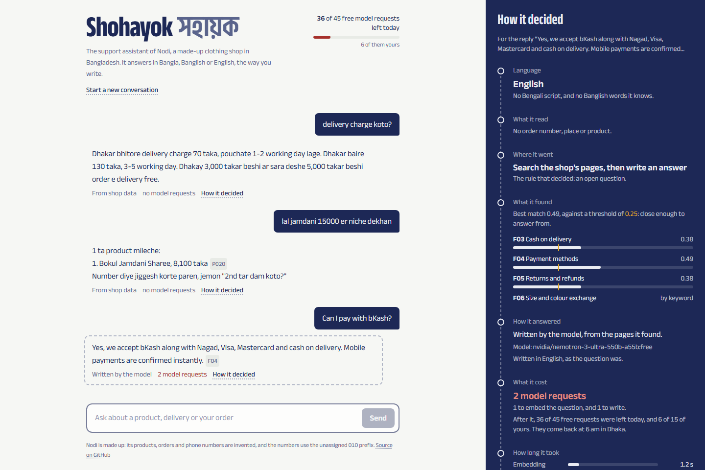
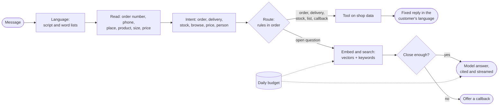

# Shohayok · সহায়ক

A customer-support agent for a Bangladeshi clothing shop. It answers in **Bangla, Banglish and English**, the way the customer writes, and it runs entirely on free tiers: Vercel, MongoDB Atlas and OpenRouter's free models.

**Try it: [shohayok-beta.vercel.app](https://shohayok-beta.vercel.app)**



Bangladeshi customers write in three ways: Bengali script, Bengali typed in English letters ("delivery charge koto?"), and English. Shohayok reads all three. Most messages are about an order, a delivery fee or whether something is in stock, and rules answer those from the shop's data with no model at all. Only open questions, such as "can I return a sharee I don't like?", go to search and a language model, which answers from the shop's own pages and cites them. When search finds nothing close enough, it offers a callback instead of guessing.

The shop, Nodi, is made up: 500 generated products, 300 orders and 15 policies, with phone numbers on the unassigned 010 prefix.

## What to try

| Ask                                              | What happens                                                                       |
| ------------------------------------------------ | ---------------------------------------------------------------------------------- |
| `amar order NDI-10299 kothay? phone 01000000002` | Finds the order, only because the phone matches. No model.                         |
| `সিলেটে ডেলিভারি চার্জ কত?`                       | The fee for Sylhet, in Bangla. No model.                                           |
| `jamdani sharee dekhao`, then `2nd ta koto?`     | A list, then the price of the second item. No model.                               |
| `Can I return a sharee if I don't like it?`      | Search, then an answer from the returns policy, cited `[F05]`. Two model requests. |
| `What's the weather like today?`                 | Nothing in the shop's pages is close: it offers a callback. One request.           |
| `NDI-10298, phone 01000000005`                   | A wrong phone gets the same reply as an unknown order, so neither can be guessed.  |

Demo orders: `NDI-10298` / `01000000001` (delivered), `NDI-10299` / `01000000002` (shipped), `NDI-10300` / `01000000003` (confirmed).

Every reply has a **How it decided** link. It opens the record of that reply: the language detected and why, what the rules read, which rule routed the message, what search found and how close it was, which model wrote the answer, the model requests it cost, and how long each step took.

## How it works



The design rule: **the model writes, the code decides.** Rules choose the route, tools read the data, and fixed templates write the replies in three languages, so an order status is never a model's guess and costs nothing. The model is used for two things only: answering an open question from the documents search found, and rewriting a message that cannot be searched alone ("oitar dam koto?" after a list).

- **Conversation memory.** The conversation keeps the last list shown, a pending question ("which phone number?") and the language, so "2nd ta koto?" and a bare phone number work as replies. Conversations expire after 7 days, and phone numbers are stored masked.
- **Search.** MongoDB Atlas Vector Search with pre-filters on category, colour and price, fused with a `$text` keyword search by reciprocal rank.
- **Safety.** An order is shown only to someone with both its number and its phone, and lookups lock after five failures in a conversation. Documents reach the model inside a fenced block that the prompt calls data, not instructions.

The reasoning behind each choice, with the alternatives, is in [docs/design.md](docs/design.md).

## The free tier

OpenRouter's free models allow 50 requests a day for the whole account, shared by every visitor. The demo spends them carefully:

| Guard                                       | Setting                                                                                 |
| ------------------------------------------- | --------------------------------------------------------------------------------------- |
| Model requests the demo may make per day    | 45, leaving 5 for maintenance                                                           |
| Model requests one visitor may make per day | 15                                                                                      |
| Messages per visitor                        | 8 a minute, 100 a day                                                                   |
| Requests per message                        | 0 for anything a tool answers; 2 for an open question; up to 4 when a rewrite is needed |
| Caches                                      | Embeddings for 30 days, first answers to a question for 7 days                          |

Counters live in MongoDB and are updated atomically, so parallel serverless functions cannot overspend. When the day's requests are gone, tools keep working, and open questions get a keyword search with links instead of an answer, until 6 am in Dhaka. A visitor is a keyed hash of the IP address; no address is stored.

## Results

<!-- results:start -->

**Partial run.** The free quota ended the first day at 82 cases. 26 cases are still to run: the off-topic and safety cases, the last policy questions, and `policy-15`, which failed on the first run (a rewrite named a product the customer never mentioned) and runs again after its fix in 5ae1de4. Its first run cost 1 request more than the total below.

Measured 2026-11-26 against MongoDB Atlas (Atlas vector search, top 4), embeddings `nvidia/nemotron-3.5-embed-1b:free` and answers `nvidia/nemotron-3-ultra-550b-a55b:free`, both free on OpenRouter. 81 of 107 cases.

|                                                  | English | Bangla | Banglish | All  |
| ------------------------------------------------ | ------- | ------ | -------- | ---- |
| Cases                                            | 36      | 23     | 22       | 81   |
| Went to the right place                          | 100%    | 100%   | 100%     | 100% |
| Read the right order, place, product and filters | 100%    | 100%   | 100%     | 100% |
| Reply states the expected facts                  | 100%    | 100%   | 100%     | 100% |
| Reply in the customer's language                 | 100%    | 100%   | 100%     | 100% |

Routing by kind of case: tool 100% of 50, answer 100% of 19, followup 100% of 12.

Safety: none of the 11 replies checked for leaks showed another customer's order, a phone number or the prompt.

Search, over 19 open questions with a known document: right document first 89%, in the top 3 100%, mean reciprocal rank 0.94.

Handoff at cosine 0.25: precision –, recall –, over 21 open questions.

| Cost and speed          | Replies from shop data | Model answers             |
| ----------------------- | ---------------------- | ------------------------- |
| Turns                   | 60                     | 21                        |
| Model requests per turn | 0.0                    | 1.0 on average, 1 at most |
| Reply time, p50         | 60 ms                  | 4.7 s                     |
| Reply time, p95         | 119 ms                 | 9.7 s                     |
| First word, p50         | –                      | 3.7 s                     |

The run spent 22 free model requests in all. The 40 open questions were embedded ahead in 1 request(s), so their turns show no embedding request and their reply times leave out one embedding call. Times include the network and the free providers’ queues.
<!-- results:end -->

`npm run eval` runs 107 labelled cases: tools, follow-ups, open questions, off-topic questions, and attempts to see someone else's order or the prompt. [results/latest.md](results/latest.md) lists every failed check.

## Run it yourself

You need Node.js 22 or newer and MongoDB 6 or newer.

```bash
npm install
cp .env.example .env     # then fill it in, see below
npm run doctor           # checks MongoDB, the provider and the models
npm run ingest           # stores the shop and embeds it for search
npm run dev              # the API on http://localhost:3000
npm run dev:web          # the page on http://localhost:5173
```

**Free models.** Set `LLM_PROVIDER=openrouter` and `OPENROUTER_API_KEY` in `.env`. The defaults are free models: `nvidia/nemotron-3.5-embed-1b:free` for embeddings and `nvidia/nemotron-3-ultra-550b-a55b:free` for answers. Keep to `:free` models on an account without credit: a paid request takes the balance below zero, which blocks the free models too.

**Local models.** With [Ollama](https://ollama.com) and a 12 GB GPU, `LLM_PROVIDER=ollama` uses `bge-m3` and `gemma3:12b`. Nothing is counted then, since local requests cost nothing.

**Vector search on your machine.** `docker compose up -d` starts MongoDB Atlas Local, with vector search, on port 27018. Without it, search runs exact cosine in the app over the stored vectors, which is fine for this shop's 515 chunks.

The data is generated: `npm run generate` writes `data/products.json` and `data/orders.json` from a fixed seed. Ingesting again embeds only the chunks whose text changed.

## Deploy to Vercel

`api/index.ts` runs the API as one Vercel function, and Vercel serves the built page from its CDN.

1. Create a free MongoDB Atlas cluster, and allow connections from anywhere under Network Access: Vercel functions have no fixed address.
2. Run `npm run ingest` once from your machine with the deployment's `MONGODB_URI`.
3. In the Vercel project, set `MONGODB_URI`, `MONGODB_DB`, `LLM_PROVIDER=openrouter`, `OPENROUTER_API_KEY` and `HASH_SECRET`.
4. Push, or run `npx vercel --prod`.

## Evaluation

```bash
npm run eval -- --offline           # no model, no database: what CI runs
npm run eval                        # against MongoDB and the models
npm run eval -- --resume            # carry on after the day's quota ended a run
npm run eval -- --only policy-01,off-03
npm run eval -- --write-readme      # update the table above, once every case has run
```

Each case names where the message should go, what the rules should read, facts the reply must state and strings it must never contain. Offline, the day's budget is zero, so every model request is refused exactly as when the quota runs out: routing, reading and every fixed reply are scored, and open questions are only checked to reach search. Online, open questions are embedded ahead in one request instead of one each, and a run stopped by the quota resumes where it left off.

## Configuration

Set in `.env`. Empty values use the default.

| Variable                          | Default                                                        | Purpose                                                                                                       |
| --------------------------------- | -------------------------------------------------------------- | ------------------------------------------------------------------------------------------------------------- |
| `MONGODB_URI`                     | `mongodb://127.0.0.1:27017`                                    | MongoDB connection string                                                                                     |
| `MONGODB_DB`                      | `shohayok`                                                     | Database name                                                                                                 |
| `DNS_SERVERS`                     | the system's                                                   | DNS servers for Node, such as `8.8.8.8,1.1.1.1`, if a `mongodb+srv` string fails with `querySrv ECONNREFUSED` |
| `LLM_PROVIDER`                    | `ollama`                                                       | Where answers and rewrites run: `ollama` or `openrouter`                                                      |
| `EMBED_PROVIDER`                  | `LLM_PROVIDER`                                                 | Where embeddings run                                                                                          |
| `OPENROUTER_API_KEY`              | none                                                           | Needed when either provider is `openrouter`                                                                   |
| `EMBED_MODEL`, `CHAT_MODEL`       | free models on OpenRouter; `bge-m3` and `gemma3:12b` on Ollama | A comma list of chat models falls back in order                                                               |
| `REWRITE_MODEL`                   | `CHAT_MODEL`                                                   | Model for rewriting a message that cannot be searched alone                                                   |
| `VECTOR_BACKEND`                  | `auto`                                                         | `atlas`, `local`, or `auto` to detect                                                                         |
| `HANDOFF_THRESHOLD`               | `0.25` for the free embedder, `0.5` for `bge-m3`               | Offer a callback below this cosine similarity                                                                 |
| `TOP_K`                           | `4`                                                            | Documents given to the model                                                                                  |
| `DAILY_MODEL_BUDGET`              | `45`                                                           | Model requests the demo may make per UTC day                                                                  |
| `VISITOR_DAILY_BUDGET`            | `15`                                                           | Model requests one visitor may make per day                                                                   |
| `RATE_PER_MINUTE`, `RATE_PER_DAY` | `8`, `100`                                                     | Messages per visitor                                                                                          |
| `HASH_SECRET`                     | derived from `MONGODB_URI`                                     | Key for the visitor hash                                                                                      |
| `PORT`                            | `3000`                                                         | HTTP port                                                                                                     |

## API

`POST /api/chat` with `{"message": "...", "conversationId": "..."}` streams newline-delimited JSON: a `meta` event with the route and sources, `token` events with the reply, and a `done` event with the full trace. `GET /api/conversations/:id` returns a conversation, `GET /api/quota` the day's budget, and `GET /api/health` the database, models and providers. The wire types are in [src/shared/api.ts](src/shared/api.ts).

## Project layout

```
src/
  shop/        vocabulary, places, delivery rates, the data generator
  nlu/         reading messages: entities and intents in three scripts
  lang/        language detection, Bengali digits
  agent/       routing, conversation state, prompts, the turn itself
  tools/       order status, delivery fee, stock, lists, callbacks
  reply/       fixed replies in three languages
  retrieval/   vector search (Atlas and in-app), keyword search, rank fusion
  limits/      daily budget, rate limits, visitor hashing
  cache/       embedding and answer caches
  llm/         OpenRouter and Ollama clients behind one interface
  store/       MongoDB access
  ingest/      chunking and loading the shop
  eval/        cases, scoring and the report
  server/      Express app
  shared/      the API's wire types, shared with the page
  cli/         doctor, generate, ingest, eval
web/           the React page
api/           the Vercel function
data/          the shop and the eval cases
```

## Tests

```bash
npm test
```

Every module without I/O has unit tests, and both model clients are tested against fake HTTP servers. When MongoDB is reachable on `127.0.0.1:27017`, or at `MONGODB_TEST_URI`, integration tests ingest the real shop, race the budget counters, and drive the whole HTTP app end to end. CI runs them on every pull request against a MongoDB service, with lint, types, formatting, the offline eval and the page build.

## License

MIT
