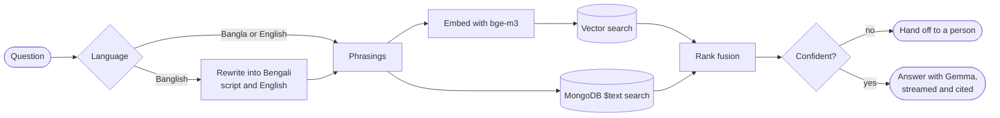

# Shohayok · সহায়ক

A customer-support assistant that answers in **Bangla, Banglish and English**, grounded in a shop's own catalogue and policies. It runs on open models, fully local through Ollama on one 12 GB GPU, or on any laptop through OpenRouter's free models. MongoDB is the only database.

Bangladeshi customers write in three ways: Bengali script, Bengali typed in English letters ("delivery charge koto?"), and English. Most retrieval stacks handle the first and last and treat Banglish as noise. Shohayok detects the language of every message, rewrites Banglish before searching, answers in the customer's own style, and hands off to a person instead of guessing.

The shop, Nodi, is fictional. Every product, policy and address in `data/` is invented.

## Highlights

- **Three languages, one pipeline.** Each message is classified as Bangla, Banglish or English, and the answer comes back the same way.
- **Banglish rewrite.** The model rewrites romanised Bengali into Bengali script and English with a JSON-schema response, and all three phrasings are searched. The eval measures what this adds.
- **Hybrid retrieval on MongoDB.** Vector search plus a `$text` keyword index, fused with reciprocal rank fusion. It uses Atlas Vector Search when the server has it, and exact cosine search in the app on any MongoDB 6+.
- **Knows when to stop.** Below a similarity threshold it hands off to a human in the customer's language, without calling the model. The eval sweeps thresholds to pick the value.
- **Local or cloud.** Ollama keeps everything on your machine. OpenRouter runs it on a laptop with no GPU, with free models for answers. Answers and embeddings can each come from either provider.
- **Streams everything.** Sources first, then the answer word by word, then per-stage timings.
- **Measured.** One command scores retrieval, answer facts, language match, handoff precision and recall, and latency on 51 labelled questions.

## How it works



1. **Detect** the language from the share of Bengali script, then from a list of common Banglish words.
2. **Rewrite** Banglish into Bengali script and English. If the rewrite fails, the search uses the original words.
3. **Embed** every phrasing in one call.
4. **Search** each phrasing by vector and by keyword, and fuse all lists by rank.
5. **Decide**: below the threshold, send a fixed handoff message.
6. **Answer** from the top chunks, citing document ids like `[F01]`.

The reasoning behind each choice, with the alternatives considered, is in [docs/design.md](docs/design.md).

## Results

<!-- results:start -->

Not measured yet. Run the eval with Ollama on a GPU, or with an OpenRouter key:

```bash
npm run eval -- --write-readme --hardware "RTX 5070 12 GB"
```

<!-- results:end -->

## Quick start

You need Node.js 22 or newer and MongoDB 6 or newer. Then choose where the models run.

**Local, on your GPU.** Install [Ollama](https://ollama.com), then:

```bash
npm install
cp .env.example .env        # Windows: copy .env.example .env
ollama pull bge-m3
ollama pull gemma3:12b
npm run doctor              # checks MongoDB, the provider and the models
npm run ingest              # chunks, embeds and stores the shop data
npm start                   # http://localhost:3000
```

The defaults fit a 12 GB GPU. On a smaller card, set `CHAT_MODEL=gemma3:4b` in `.env`.

**OpenRouter, no GPU needed.** Create a key on [openrouter.ai](https://openrouter.ai), set these two lines in `.env`, and run the same `doctor`, `ingest` and `start` commands:

```bash
LLM_PROVIDER=openrouter
OPENROUTER_API_KEY=sk-or-...
```

Answers then come from `google/gemma-4-31b-it:free`. Embeddings use `baai/bge-m3`, which costs about $0.01 per million tokens, so the account needs a little credit. To spend nothing at all, either set `EMBED_PROVIDER=ollama` and run `bge-m3` locally, which is small enough for a CPU, or set `EMBED_MODEL=nvidia/nemotron-3.5-embed-1b:free`, which is free but untested on Bengali.

Free models on OpenRouter are rate-limited: about 20 requests a minute, and a small daily allowance until the account has bought $10 of credits. A full eval run makes about 70 requests, so on a fresh account use `--limit` or add credits. The client waits and retries on per-minute limits, and stops with a clear message at the daily one.

To use Atlas Vector Search on your own machine instead of the in-app search:

```bash
docker compose up -d
# in .env: MONGODB_URI=mongodb://127.0.0.1:27018/?directConnection=true
npm run ingest
```

## Evaluation

`data/eval.json` holds 51 questions: 17 in each language, of which 2 have no answer in the data.

| Metric                       | Meaning                                                                      |
| ---------------------------- | ---------------------------------------------------------------------------- |
| Language detected            | The detector agrees with the label                                           |
| Right document first / top 3 | An expected document is ranked first, or within the top 3                    |
| Mean reciprocal rank         | 1 / rank of the first expected document, averaged                            |
| Expected fact                | The answer contains the expected price, number or name, in any digits        |
| Customer's language          | The answer is written the way the question was                               |
| Handoff precision, recall    | Handoff treated as a classifier for "the answer is not in the data"          |
| Latency                      | p50 and p95 for retrieval, the first word of the answer, and the full answer |

```bash
npm run eval                        # full run, results in results/latest.md
npm run eval -- --retrieval-only    # retrieval metrics only, no generation
npm run eval -- --limit 10          # first 10 questions
npm run eval -- --write-readme --hardware "RTX 5070 12 GB"
```

Every Banglish question is also retrieved without the rewrite step, so the report shows what the rewrite adds. The report names the provider of each model, and notes when cloud latency includes the network.

## Configuration

Set in `.env`. Empty values use the default.

| Variable             | Default                                                            | Purpose                                                                                                              |
| -------------------- | ------------------------------------------------------------------ | -------------------------------------------------------------------------------------------------------------------- |
| `LLM_PROVIDER`       | `ollama`                                                           | Where answers and the Banglish rewrite run: `ollama` or `openrouter`                                                 |
| `EMBED_PROVIDER`     | `LLM_PROVIDER`                                                     | Where embeddings run                                                                                                 |
| `OLLAMA_URL`         | `http://127.0.0.1:11434`                                           | Ollama server                                                                                                        |
| `OPENROUTER_API_KEY` | none                                                               | Needed when either provider is `openrouter`                                                                          |
| `OPENROUTER_URL`     | `https://openrouter.ai/api/v1`                                     | OpenRouter API                                                                                                       |
| `EMBED_MODEL`        | `bge-m3` on Ollama, `baai/bge-m3` on OpenRouter                    | Embedding model                                                                                                      |
| `CHAT_MODEL`         | `gemma3:12b` on Ollama, `google/gemma-4-31b-it:free` on OpenRouter | Answer model                                                                                                         |
| `REWRITE_MODEL`      | `CHAT_MODEL`                                                       | Model for the Banglish rewrite                                                                                       |
| `MONGODB_URI`        | `mongodb://127.0.0.1:27017`                                        | MongoDB connection string                                                                                            |
| `MONGODB_DB`         | `shohayok`                                                         | Database name                                                                                                        |
| `DNS_SERVERS`        | the system's                                                       | DNS servers for Node, such as `8.8.8.8,1.1.1.1`. Set it if a `mongodb+srv` string fails with `querySrv ECONNREFUSED` |
| `VECTOR_BACKEND`     | `auto`                                                             | `atlas`, `local`, or `auto` to detect                                                                                |
| `HANDOFF_THRESHOLD`  | `0.5`                                                              | Hand off below this cosine similarity                                                                                |
| `TOP_K`              | `4`                                                                | Chunks given to the answer model                                                                                     |
| `PORT`               | `3000`                                                             | HTTP port                                                                                                            |

## API

`POST /api/chat` with `{"message": "..."}` streams newline-delimited JSON:

```json
{"type":"meta","lang":"banglish","rewrite":{"bangla":"...","english":"..."},"handoff":false,"confidence":0.71,"sources":[{"docId":"P01","title":"..."}]}
{"type":"token","text":"Tangail sharee er dam "}
{"type":"done","answer":"...","timings":{"rewriteMs":410,"embedMs":35,"searchMs":6,"firstTokenMs":980,"totalMs":2100}}
```

`GET /api/health` reports the vector backend, chunk count, models, providers, and whether the providers answer.

## Project layout

```
src/
  lang/        language detection, Bengali digits
  corpus/      data schemas and loading
  ingest/      chunking
  llm/         Ollama and OpenRouter clients behind one interface
  retrieval/   vector search (Atlas and in-app), $text search, rank fusion
  rag/         Banglish rewrite, prompt, handoff, the pipeline
  store/       MongoDB access
  eval/        metrics and the report
  server/      Express app
  cli/         doctor, ingest, eval
public/        the chat page, no build step
data/          catalogue, policies and eval questions
test/          unit and integration tests
```

## Tests

```bash
npm test
```

Every model-free module has unit tests. Both model clients are tested against fake HTTP servers, including answers split mid-character across network reads, rate limits, rejected keys and models that refuse JSON schemas. When a MongoDB is reachable on `127.0.0.1:27017`, or at `MONGODB_TEST_URI`, the integration tests store the real corpus, search it in Bengali and Banglish, and drive the whole HTTP app end to end once per provider with a stand-in server. They are skipped when no MongoDB is running.

`npm run typecheck`, `npm run lint` and `npm run format:check` keep the rest honest.

## License

MIT
